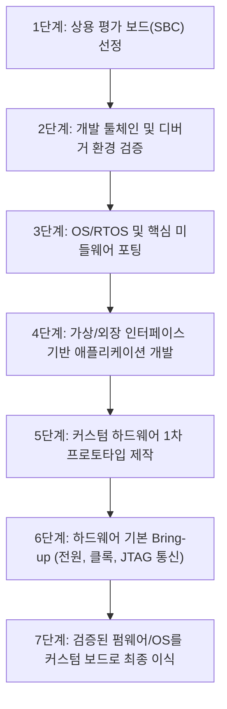

# 📘 Embedded Hardware: Know It All
## Chapter 7, 8, 9 핵심 내용 종합 분석 및 실무 가이드

> **참고 도서 정보**
> - **도서명:** *Embedded Hardware: Know It All* (Newnes / Elsevier)
> - **대상 챕터:**
>   - **Chapter 7:** Choosing a Microcontroller and Other Design Decisions (Lewin Edwards)
>   - **Chapter 8:** The Essence of Microcontroller Networking: RS-232, I2C, SPI, CAN (Fred Eady, Creed Huddleston)
>   - **Chapter 9:** Interfacing to Sensors and Actuators (Kamal Hyder, Bob Perrin)

---

## 📑 목차
1. [Chapter 7: 마이크로컨트롤러 선정 및 설계 의사결정](#1-chapter-7-마이크로컨트롤러-선정-및-설계-의사결정)
   - 1.1 부품 선정 및 조달의 현실
   - 1.2 프로세서 코어 선택 기준 (8-bit vs 16-bit vs 32-bit)
   - 1.3 FPGA / CPLD를 활용한 커스텀 주변장치
   - 1.4 하드웨어 개발 순서: 닭과 달걀 딜레마 극복 (7단계 이식 전략)
   - 1.5 권장 실험실 장비 구성
   - 1.6 개발 툴체인 및 디버거
   - 1.7 무료 임베디드 운영체제(RTOS) 비교
   - 1.8 오픈소스 라이선스(GNU/GPL)의 법적·기술적 영향
2. [Chapter 8: 마이크로컨트롤러 네트워킹과 직렬 통신](#2-chapter-8-마이크로컨트롤러-네트워킹과-직렬-통신)
   - 2.1 RS-232 직렬 통신 (원리, 전압 레벨, 전하 펌프, 비트뱅잉)
   - 2.2 I2C 버스 프로토콜 (2선식 동기 통신, 오픈드레인, 주소 지정, 중재, 동기화)
   - 2.3 SPI 버스 프로토콜 (고속 4선 전이중 통신, 클록 모드)
   - 2.4 CAN 버스 프로토콜 (차동 신호, 비트 중재, 오류 제어, 하드웨어 수락 필터)
   - 2.5 시리얼 통신 프로토콜 종합 비교 매트릭스
3. [Chapter 9: 센서 및 액추에이터 인터페이싱](#3-chapter-9-센서-및-액추에이터-인터페이싱)
   - 3.1 3.3V와 5V 로직 레벨 혼용 및 변환 기법
   - 3.2 디지털 입력 보호 회로 (ESD, 과전압 클램핑, 절연)
   - 3.3 디지털 I/O 확장 기법 (Shift Register 활용)
   - 3.4 고전류 구동 회로 (BJT, MOSFET, 릴레이, 역기전력 보호)
   - 3.5 아날로그 인터페이싱 및 ADC 채널 특성화 (노이즈 정량화, ENOB)
4. [종합 아키텍처 설계 체크리스트](#4-종합-아키텍처-설계-체크리스트)

---

## 1. Chapter 7: 마이크로컨트롤러 선정 및 설계 의사결정
> **저자:** Lewin Edwards (*Embedded System Design on a Shoestring*)

임베디드 프로젝트 초기 단계는 요구사항의 불확실성, 부품 수급의 난항, 예산 제약 등으로 인해 가장 위험도가 높은 시기입니다. 7장에서는 시행착오와 개발 비용을 최소화하면서 성공적으로 MCU와 아키텍처를 결정하는 실무적 방법론을 제시합니다.

### 1.1 부품 선정 및 조달의 현실 (Component Procurement)
- **파라메트릭 검색 엔진의 한계**:
  - 온라인 파라메트릭 검색 툴은 제조사별 폐쇄적 DB를 기반으로 작동하며, 툴체인 비용이나 최소 주문 수량(MOQ), 실제 공급 가능성(Lead time)을 반영하지 못함.
- **피어 서포트(Peer Support) 및 커뮤니티의 중요성**:
  - 실제 실무 엔지니어들의 Usenet 포럼, 기술 커뮤니티(Stack Overflow, EEVblog 등)의 경험담을 통해 데이터시트에 없는 칩 버그(Errata), 공급 불안정성, 개발 보드 추천 정보를 파악하는 것이 필수적임.
- **유통업체(Distributor)와 벤더 관계 관리**:
  - 소량 생산자(스타트업, 연구자)는 공식 대리점으로부터 우선순위가 밀리기 쉬우므로, Digikey, Mouser 등 카탈로그 유통사를 통해 즉시 구매 가능한 기성 부품을 우선 검토해야 함.

### 1.2 프로세서 코어 선택 기준
| 구분 | 8-bit / 16-bit (AVR, PIC, 8051, MSP430) | 32-bit (ARM7TDMI, Cortex-M, MIPS, ColdFire) |
| :--- | :--- | :--- |
| **적합한 작업** | 단순 I/O 제어, 타이머, 센서 수집, 초저전력 배터리 기기 | 네트워크 스택(TCP/IP), GUI, 파일 시스템, 대용량 버퍼링, 복잡한 DSP 연산 |
| **개발 편의성** | 직관적인 레지스터 제어, 단일 전원, DIP/QFP 패키징 | C/C++ 컴파일러 최적화 용이, 풍부한 미들웨어/RTOS 생태계 |
| **시스템 비용** | 칩 단가 매우 낮음, 2층 PCB로 구현 가능 | 칩 단가 저렴해졌으나 BGA/다층 기판(4~6층), 고속 바이패스 커패시터 등 주변 비용 증가 가능 |
| **메모리 구조** | 온칩 Flash/RAM 위주, 외부 버스 확장 제한적 | 온칩 대용량 메모리 또는 외부 SDRAM/DDR/Flash 인터페이스 내장 |

- **핵심 원칙**: 
  - 과거에는 단가 문제로 8비트를 선호했으나, 32비트 MCU(ARM 계열)의 단가가 급격히 하락하고 툴체인이 성숙함에 따라 펌웨어 유지보수성, 코드 재사용성, 기능 확장성을 고려할 때 32비트 진입 장벽이 크게 낮아졌음.
  - 온칩 플래시/RAM이 프로젝트 전체 요구량을 수용할 수 있는지(외부 메모리 인터페이스 생략 가능 여부)가 기판 설계 난이도와 노이즈 저감의 핵심 분기점임.

### 1.3 FPGA / CPLD를 활용한 커스텀 주변장치
- **CPLD (Complex Programmable Logic Device)**: 비휘발성, 즉시 동작(Instant-on), 저렴한 비용으로 버스 브리징, 주소 디코딩, 글루 로직(Glue logic)에 최적.
- **FPGA (Field Programmable Gate Array)**: 대규모 연산 병렬화, 고속 비디오/오디오 스트리밍 처리, 표준 규격 외 독자 통신 프로토콜 인터페이싱에 적합.
- **선정 기준**: 프로젝트 초기 불명확한 하드웨어 요구사항을 소프트웨어 업데이트처럼 칩 내부 로직 변경으로 해결할 수 있는 유연성을 제공하나, 단가(BOM)와 전력 소비, 외부 부팅 ROM 설계 부담을 함께 고려해야 함.

### 1.4 하드웨어 개발 순서: 닭과 달걀 딜레마 극복 (7단계 전략)
자체 커스텀 보드가 완성되기 전까지 펌웨어 개발이 정체되는 문제를 방지하기 위해 상용 레퍼런스/평가 보드(SBC)를 적극 활용하는 7단계 이식 전략을 제안합니다:

### 1.5 권장 실험실 장비 구성
1. **DSO (Digital Storage Oscilloscope)**: 최소 2채널(권장 4채널), 신호 대역폭은 버스 클록의 최소 3~5배 이상(예: 100MHz 이상), SPI/I2C 디코딩 지원 권장.
2. **로직 분석기 (Logic Analyzer)**: 다채널(8~32채널) 디지털 신호 타이밍 분석 및 프로토콜 분석.
3. **선형 벤치 전원공급기 (Linear Benchtop PSU)**: 정밀 전류 제한(Current Limit) 설정이 가능한 듀얼 채널 전원 (스위칭 노이즈가 없는 리니어 방식 추천).
4. **정밀 DMM (디지털 멀티미터)**: 4.5 디지트 이상, True-RMS, 미소 전류(μA) 측정 지원.
5. **온도 조절 납땜/디솔더링 스테이션 & ESD 방지 매트/접지 밴드**.

### 1.6 개발 툴체인 및 디버거
- **상용 툴체인 (Keil, IAR)**: 강력한 최적화 컴파일러, 직관적 GUI 디버거를 제공하지만 고가의 라이선스 비용 발생.
- **오픈소스 툴체인 (GNU Toolchain)**: GCC, GDB, binutils, newlib 조합으로 라이선스 비용이 없고 CI/CD 자동화 빌드에 최적화됨.
- **하드웨어 디버깅**: JTAG / SWD / BDM 인터페이스 및 OpenOCD, Wiggler, J-Link 등을 결합하여 온칩 하드웨어 브레이크포인트 및 플래시 프로그래밍 수행.

### 1.7 무료 임베디드 운영체제(RTOS) 비교
- **FreeRTOS**: 극도로 가벼운 풋프린트, 간결한 소스코드, 선점형 멀티태스킹, 마이크로컨트롤러 표준.
- **eCos (Embedded Configurable Operating System)**: 하드 실시간성, 깊이 있는 설정 가능성(컴포넌트 단위 빌드), 내장 네트워크 스택.
- **uC/OS-II**: 교육용 및 산업 인증용으로 널리 검증된 선점형 실시간 커널.
- **임베디드 리눅스 (uClinux 등)**: MMU가 없는 MCU를 위한 리눅스 포팅 버전. 풍부한 네트워크 스택 및 유닉스 도구를 지원하나 부팅 시간과 메모리(RAM) 요구량이 큼.

### 1.8 오픈소스 라이선스(GNU/GPL)의 영향
- **GPL (General Public License)**: GPL 코드를 정적/동적으로 링크하여 생성된 파생 저작물(Firmware 이미지)은 전체 소스코드를 공개해야 하는 전염성(Copyleft)이 있음. 상용 독점 펌웨어에 치명적일 수 있음.
- **LGPL (Lesser GPL)**: 라이브러리 형태 동적 링크 시 독점 코드 보호가 가능하나, 정적 링크 위주의 단일 바이너리 임베디드 환경에서는 분리가 까다로움.
- **BSD / MIT / Apache**: 소스코드 공개 의무가 없으며, 저작권 고지만 유지하면 상용 제품에 자유롭게 통합 가능하여 임베디드 하드웨어 제품에 가장 안전함.

---

## 2. Chapter 8: 마이크로컨트롤러 네트워킹과 직렬 통신
> **저자:** Fred Eady, Creed Huddleston

임베디드 시스템에서 칩 간, 기기 간 통신은 필수적입니다. 8장에서는 레거시 시리얼(RS-232)부터 칩 간 통신의 표준(I2C, SPI), 산업용 고신뢰성 버스(CAN)까지 통신의 물리적 계층과 프로토콜 동작 메커니즘을 심층 분석합니다.

### 2.1 RS-232 직렬 통신
- **DTE vs DCE**:
  - DTE(Data Terminal Equipment, 예: PC, 단말기)와 DCE(Data Communications Equipment, 예: 모뎀).
  - DTE-DCE 간은 1:1 직결(Straight Cable), DTE-DTE 상호 연결 시는 TX/RX가 교차된 널 모뎀(Null Modem) 케이블 사용.
- **전기적 특성 및 전압 레벨**:
  - 표준 논리(TTL/CMOS)와 반대되는 역논리(Negative Logic) 체계:
    - **Logic 0 (Space)**: $+3\text{V} \sim +15\text{V}$ (공칭 $+12\text{V}$)
    - **Logic 1 (Mark)**: $-3\text{V} \sim -15\text{V}$ (공칭 $-12\text{V}$, 유휴 상태 Idle)
    - 미정의 영역: $-3\text{V} \sim +3\text{V}$
- **전하 펌프(Charge Pump) 전압 변환기 (MAX232 / MAX3232)**:
  - 단일 $+5\text{V}$ 또는 $+3.3\text{V}$ 공급 전원에서 외장 커패시터 4개를 이용하여 내부 차지 펌프로 $\pm 10\text{V}$ 전압을 승압/반전 생성.
- **소프트웨어 비트뱅잉(Bit-Banging) 구현**:
  - 하드웨어 UART가 없는 8핀 MCU(예: PIC12F675)에서 GPIO 핀과 정밀 타이머 루프를 통해 전송률(Baud rate) 주기($T = 1/\text{Baud}$)에 맞춰 Start bit(Low) $\rightarrow$ 8 Data bits(LSB부터 전송) $\rightarrow$ Stop bit(High)를 생성.

### 2.2 I2C 버스 프로토콜 (Inter-Integrated Circuit)
- **물리적 구성**:
  - 2선식 버스: **SDA** (Serial Data), **SCL** (Serial Clock).
  - 모든 장치의 핀은 **오픈 드레인(Open-Drain) / 오픈 컬렉터** 구조이며, 버스 라인마다 단일 **풀업 저항(Pull-up Resistor, 통상 $2.2\text{k}\Omega \sim 10\text{k}\Omega$)**이 필수.
  - 와이어드 AND(Wired-AND) 구조를 통해 여러 장치가 동시에 라인을 Low로 당길 수 있음.
- **버스 속도 규격**:
  - Standard Mode: 최대 $100\text{ kbps}$
  - Fast Mode: 최대 $400\text{ kbps}$
  - High-Speed Mode: 최대 $3.4\text{ Mbps}$
- **신호 조건 및 유효성 규칙**:
  - **데이터 안정성**: SCL이 High인 동안 SDA 라인의 상태는 변경되지 않고 안정되어야 함.
  - **START 조건**: SCL이 High인 상태에서 SDA가 High $\rightarrow$ Low로 하강 천이.
  - **STOP 조건**: SCL이 High인 상태에서 SDA가 Low $\rightarrow$ High로 상승 천이.
- **통신 프레임 및 ACK/NACK**:
  - 1바이트 전송(8비트) 후 9번째 클록에서 수신 장치가 SDA를 Low로 당기면 **ACK**, High로 유지하면 **NACK**.
  - 주소 체계: 7비트 주소 + 1비트 R/W 플래그(0: Write, 1: Read). (10비트 확장 주소 모드 지원).
- **중재(Arbitration) 및 클록 스트레칭(Clock Stretching)**:
  - **다중 마스터 중재**: 마스터 여러 개가 동시 송신 시, 자신이 High를 전송했음에도 버스(SDA)가 Low로 감지되면 중재 패배로 판정하고 즉시 송신을 중단(비파괴 중재).
  - **클록 스트레칭**: 슬레이브가 처리 시간을 벌기 위해 SCL 라인을 의도적으로 Low 상태로 유지하면, 마스터는 SCL이 High가 될 때까지 클록 생성을 대기함.

### 2.3 SPI 버스 프로토콜 (Serial Peripheral Interface)
- **특징**: 모토로라가 개발한 4선식 동기식 전이중(Full-Duplex) 고속 직렬 통신.
- **신호 라인**:
  - **SCLK**: 마스터가 생성하는 직렬 클록.
  - **MOSI** (Master Out Slave In): 마스터에서 슬레이브로의 데이터 전송.
  - **MISO** (Master In Slave Out): 슬레이브에서 마스터로의 데이터 전송.
  - **SS / CS** (Slave Select / Chip Select): 슬레이브 활성화 신호(Active Low).
- **4가지 클록 동작 모드**:
  - **CPOL (Clock Polarity)**: 0이면 유휴 상태 Low, 1이면 유휴 상태 High.
  - **CPHA (Clock Phase)**: 0이면 첫 번째 클록 에지에서 데이터 샘플링, 1이면 두 번째 클록 에지에서 샘플링.
  - Mode 0 (CPOL=0, CPHA=0), Mode 1 (CPOL=0, CPHA=1), Mode 2 (CPOL=1, CPHA=0), Mode 3 (CPOL=1, CPHA=1).
- **장단점**: 주소 오버헤드와 복잡한 프로토콜 없이 수십 MHz 이상의 초고속 전송이 가능하나, 슬레이브 장치가 늘어날수록 전용 CS 핀이 추가로 필요함.

### 2.4 CAN 버스 프로토콜 (Controller Area Network)
- **배경**: Bosch에서 자동차 및 가혹한 산업 환경의 노이즈 내성을 위해 개발한 다중 마스터 차동 시리얼 버스.
- **물리 계층 및 차동 신호**:
  - 신호선: **CAN_H**, **CAN_L**.
  - 양 끝단에 **$120\Omega$ 종단 저항(Termination Resistor)** 배치 (선로 임피던스 정합 및 신호 반사 방지, 전체 버스 저항은 병렬 $60\Omega$).
  - **Recessive (열성, 논리 1)**: CAN_H $\approx 2.5\text{V}$, CAN_L $\approx 2.5\text{V}$ ($\Delta V \approx 0\text{V}$).
  - **Dominant (우성, 논리 0)**: CAN_H $\approx 3.5\text{V}$, CAN_L $\approx 1.5\text{V}$ ($\Delta V \approx 2.0\text{V}$). Dominant가 Recessive를 덮어씀.
- **비트 단위 비파괴 중재 (Bitwise Non-destructive Arbitration)**:
  - 노드 주소가 아닌 **메시지 식별자(ID)**를 기반으로 우선순위 결정.
  - ID 값이 작을수록(앞쪽 비트에 0이 많을수록) Dominant 비트가 유지되어 더 높은 우선순위를 가지며, 중재에서 패배한 노드는 수신 모드로 전환됨.
- **프레임 종류**:
  - Standard Frame (11-bit ID) / Extended Frame (29-bit ID).
  - Data Frame, Remote Frame, Error Frame, Overload Frame.
- **하드웨어 수락 필터(Acceptance Filters) & 마스크(Masks)**:
  - 수신 컨트롤러가 수신된 ID를 하드웨어 레벨에서 필터링하여, CPU 인터럽트 오버헤드 없이 관심 있는 패킷만 수신 버퍼에 저장.

### 2.5 직렬 통신 프로토콜 종합 비교 매트릭스
| 특성 | RS-232 | I2C | SPI | CAN |
| :--- | :--- | :--- | :--- | :--- |
| **통신 방식** | 비동기 (Asynchronous) | 동기 (Synchronous) | 동기 (Synchronous) | 비동기 차동 (Differential) |
| **신호선 수** | 2~3선 (TX, RX, GND) | 2선 (SDA, SCL) | 4선 (MOSI, MISO, SCK, CS) | 2선 (CAN_H, CAN_L) |
| **전송 속도** | 최대 $115.2\text{ kbps}$ (일반) | $100\text{k} \sim 3.4\text{ Mbps}$ | 수 $\text{MHz} \sim 50\text{+ MHz}$ | 최대 $1\text{ Mbps}$ (CAN-FD $5\text{+ Mbps}$) |
| **최대 거리** | 최대 $15\text{ m}$ | 기판 내 단거리 ($< 1\sim 2\text{ m}$) | 초단거리 칩 간 ($< 30\text{ cm}$) | 최대 $1\text{ km}$ ($40\text{ m}$ @ 1Mbps) |
| **토폴로지** | 1:1 점대점 (Point-to-Point) | 멀티 드롭 (다중 마스터/슬레이브) | 1:N (개별 CS 핀 필요) | 멀티 마스터 버스 |
| **노이즈 내성** | 보통 (단일 종단 큰 전압스윙) | 낮음 (오픈드레인, 노이즈 민감) | 낮음 (단일 종단 고속 신호) | **매우 높음 (차동 신호 + CRC)** |
| **주요 용도** | 디버깅 콘솔, PC 연동 | 센서, RTC, EEPROM 연결 | 고속 Flash 메모리, LCD 디스플레이 | 차량용 전장, 공장 자동화, 로봇 제어 |

---

## 3. Chapter 9: 센서 및 액추에이터 인터페이싱
> **저자:** Kamal Hyder, Bob Perrin

마이크로컨트롤러가 실제 물리 세계와 상호작용하기 위해서는 전압 변환, 서지 보호, 전력 구동, 아날로그 신호 처리 기술이 필수적입니다. 9장에서는 회로 고장과 노이즈 오작동을 방지하는 실무 엔지니어링 인터페이싱 기법을 다룹니다.

### 3.1 3.3V와 5V 로직 레벨 혼용 및 변환 기법
- **배경**: 현대 고성능 MCU는 전력 소모 저감($P \propto V^2$)을 위해 $3.3\text{V}$ 이하 로직을 사용하지만, 산업용 센서나 레거시 부품은 여전히 $5\text{V}$를 사용함.
- **로직 레벨 임계값 분석**:
  - $5\text{V}$ TTL: $V_{IH(\min)} = 2.0\text{V}$, $V_{IL(\max)} = 0.8\text{V}$
  - $5\text{V}$ CMOS: $V_{IH(\min)} \approx 3.5\text{V}$ ($0.7 \times V_{CC}$), $V_{IL(\max)} \approx 1.5\text{V}$ ($0.3 \times V_{CC}$)
  - $3.3\text{V}$ LVTTL/LVCMOS: $V_{OH(\min)} \approx 2.4\text{V}$, $V_{OL(\max)} \approx 0.4\text{V}$
- **구동 방향별 인터페이스 솔루션**:
  1. **$3.3\text{V}$ 출력 $\rightarrow$ $5\text{V}$ 입력**:
     - $5\text{V}$ TTL 호환 칩(예: 74HCT 시리즈): $3.3\text{V}$ 출력이 $2.4\text{V}$ 이상이므로 $V_{IH(\min)}(2.0\text{V})$을 만족하여 **직접 연결 가능**.
     - $5\text{V}$ 순수 CMOS 칩(예: 74HC 시리즈): $V_{IH(\min)}(3.5\text{V})$에 미달하므로 오동작 위험. 반드시 전용 레벨 시프터나 풀업 저항 구동 회로 필요.
  2. **$5\text{V}$ 출력 $\rightarrow$ $3.3\text{V}$ 입력**:
     - **저항 분압기 (Resistor Divider)**: 저속 신호에 적합 (예: $2\text{k}\Omega : 3.3\text{k}\Omega$ 분압).
     - **5V-Tolerant 버퍼/게이트**: 74LVC4245, 74LVC1G125 등 $3.3\text{V}$ 전원으로 동작하면서 $5\text{V}$ 입력을 허용하는 칩 활용.
     - **클램핑 다이오드 & 직렬 저항**: 쇼트키 다이오드로 $3.3\text{V}$ 레일로 클램핑하고 전류 제한 저항 삽입.

### 3.2 디지털 입력 보호 회로
현장 환경에서 발생하는 정전기 방전(ESD), 유도성 스파이크, 배선 실수에 대비한 다계층 방어 전략:

- **내부 ESD 다이오드의 한계**: 칩 내부 다이오드는 수 mA 수준의 전류만 견디므로, 큰 서지가 유입되면 칩 래치업(Latch-up)이나 파괴가 발생함.
- **외부 보호 소자**:
  - **TVS (Transient Voltage Suppressor) 다이오드**: 피코초 단위의 초고속 응답으로 고전압 서지를 접지로 방류.
  - **쇼트키 다이오드 (Schottky Diode)**: 낮은 순방향 전압 강하($V_F \approx 0.3\text{V}$)로 내부 다이오드보다 먼저 도통되어 칩을 보호.
  - **광절연기 (Optocoupler)**: 수천 볼트의 완전한 갈바닉 절연(Galvanic Isolation)을 제공하여 접지 루프 및 고전압 시스템 분리.

### 3.3 디지털 I/O 확장 기법
- **입력 확장 (Parallel-in, Serial-out)**:
  - **74HC165**: 8개 스위치/센서 디지털 입력을 단 3~4개의 MCU 핀(클록, 래치, 직렬 데이터)으로 읽어들임. 데이지 체인으로 무한 확장 가능.
- **출력 확장 (Serial-in, Parallel-out)**:
  - **74HC595**: 시프트 레지스터와 출력 저장 래치(Storage Latch)를 내장하여, 시프트 중 중간 상태의 깜빡임 없이 안정적인 8채널 디지털 출력 구동.

### 3.4 고전류 구동 회로 및 전력 스위칭
MCU의 GPIO 핀은 최대 $10 \sim 25\text{mA}$만 출력할 수 있으므로, 릴레이, 모터, 고휘도 LED, 솔레노이드 구동 시 드라이버 회로가 필수적입니다.

1. **BJT (바이폴라 트랜지스터) 로우사이드 드라이버**:
   - NPN 트랜지스터 포화(Saturation)를 위한 베이스 저항 계산:
     $$I_B \ge \frac{I_C}{\beta_{\text{sat}}} \quad (\text{통상 확실한 포화를 위해 } \beta_{\text{sat}} = 10 \sim 20 \text{ 적용})$$
     $$R_B = \frac{V_{GPIO} - V_{BE(\text{sat})}}{I_B} = \frac{3.3\text{V} - 0.7\text{V}}{I_B}$$
   - **달링턴 어레이 (ULN2803)**: 트랜지스터 8채널과 내장 환류 다이오드를 집적하여 편리하게 릴레이 구동 가능.
2. **MOSFET 스위칭**:
   - **Logic-Level N-Channel MOSFET**: 게이트 문턱전압($V_{GS(th)}$)이 낮아 $3.3\text{V}$나 $5\text{V}$ 로직 신호로 완전히 턴온되어 온-저항($R_{DS(on)}$)을 수십 $\text{m}\Omega$ 수준으로 낮출 수 있는 소자 선택 필수.
   - **게이트 저항 구성**: 고속 스위칭 시 게이트 입력 커패시턴스($C_{iss}$)로 인한 돌입 전류를 제한하는 직렬 저항($10 \sim 100\Omega$)과, MCU 리셋/부팅 시 오동작 방지를 위한 게이트-소스 간 풀다운 저항($10\text{k}\sim 100\text{k}\Omega$) 배치.
3. **유도성 부하(Inductive Load)와 플라이백 다이오드 (Flyback Diode)**:
   - 릴레이 코일, 모터 등의 전원을 차단하는 순간 인덕턴스에 의해 급격한 역기전력 발생:
     $$V = -L \frac{di}{dt}$$
   - 수백 볼트 이상의 역기전력이 스위칭 소자를 파괴하는 것을 방지하기 위해, 코일 양단에 역방향으로 고속 다이오드(1N4148, 1N4007, 쇼트키)를 병렬 연결하여 에너지를 순환 방전시켜야 함.
4. **전자기계식 릴레이(EMR) vs 솔리드 스테이트 릴레이(SSR)**:
   - **EMR**: 접점 저항이 매우 낮고 AC/DC를 가리지 않으며 완전 절연되지만, 물리적 접점 마모, 채터링(Chattering), 스위칭 속도 한계가 있음.
   - **SSR**: 반도체(트라이악, 포토MOSFET) 기반 무소음 스위칭, 긴 수명, 고속 제어가 가능하나, 도통 시 발열 및 전압 강하, 미세 누설 전류가 존재함.

### 3.5 아날로그 인터페이싱 및 ADC 채널 특성화
- **ADC 기본 개념**:
  - 분해능(Resolution, $N$ 비트)에 따른 최소 전압 분해능 LSB:
    $$\text{LSB} = \frac{V_{\text{REF}}}{2^N}$$
- **아날로그 채널 특성화 실습 (Characterizing an Analog Channel)**:
  - 정밀 기준 전압원(Precision Voltage Reference)을 샘플링하여 수천 개의 데이터를 수집한 뒤 히스토그램과 통계적 편차를 분석.
  - **노이즈 정량화**: 표준편차($\sigma$)와 RMS 노이즈를 계산하여 실제 시스템의 **유효 비트수(ENOB, Effective Number of Bits)** 산출:
    $$\text{ENOB} = N - \log_2\left(\frac{\sigma_{\text{measured}}}{\sigma_{\text{ideal}}}\right)$$
- **아날로그 정밀도 향상 기법**:
  1. **접지 분리**: 아날로그 접지(AGND)와 디지털 접지(DGND)를 분리 배선하고 전원 입력부 근처의 단일 지점(Star ground) 또는 페라이트 비드로 연결.
  2. **디커플링 및 레퍼런스 필터링**: $V_{\text{REF}}$ 핀 및 $V_{DDA}$ 핀에 세라믹($0.1\mu\text{F}$) 및 탄탈/전해($10\mu\text{F}$) 커패시터 최단 거리 배치.
  3. **앤티앨리어싱 필터(Anti-aliasing Filter)**: 나이퀴스트 주파수 이상의 고주파 노이즈 성분을 사전에 차단하기 위한 1차 또는 2차 아날로그 RC 저역통과 필터 구성.
  4. **오버샘플링(Oversampling) & 데시메이션(Decimation)**: 소프트웨어적으로 샘플을 $4^M$번 측정하여 합산함으로써 분해능을 $M$ 비트 확장하고 화이트 가우시안 노이즈 저감.

---

## 4. 종합 아키텍처 설계 체크리스트

| 설계 영역 | 주요 점검 항목 | 권장 조치 및 베스트 프랙티스 |
| :--- | :--- | :--- |
| **코어 및 메모리** | 32비트 MCU 내부 메모리 용량 | 외부 메모리 추가 없이 Flash/RAM 수용 가능한 단일 칩 솔루션 우선 채택 |
| **개발 프로세스** | 하드웨어 제작 지연 방지 | 상용 평가 보드에서 OS 및 핵심 펌웨어를 먼저 개발/검증하는 7단계 이식법 적용 |
| **라이선스** | 독점 펌웨어 지적재산권(IP) 보호 | GPL 라이브러리의 무분별한 링크 방지, BSD/MIT 라이선스 미들웨어 우선 채택 |
| **직렬 버스 설계** | I2C 버스 풀업 저항 정합 | 버스 정전용량($C_b$)에 맞춰 $2.2\text{k}\Omega \sim 4.7\text{k}\Omega$ 풀업 저항 선정 |
| **고신뢰성 통신** | CAN 버스 종단 및 노이즈 대책 | 버스 양 끝단 $120\Omega$ 종단 저항, 차동 트위스트 페어 케이블, 하드웨어 필터 설정 |
| **로직 레벨 정합** | $3.3\text{V} \leftrightarrow 5\text{V}$ 상호 연결 | 5V TTL 입력은 직결 가능하나, 5V CMOS 입력 연결 시 레벨 시프터 필수 배치 |
| **디지털 입력 보호** | 외부 센서 라인 서지 보호 | 직렬 저항($100\Omega \sim 1\text{k}\Omega$), 외부 쇼트키 다이오드 클램프, TVS 다이오드 다계층 적용 |
| **전력 스위칭** | 유도성 부하 스위칭 소자 보호 | 릴레이/솔레노이드 코일 양단에 플라이백 다이오드 역병렬 필수 연결 |
| **아날로그 정밀도** | ADC 입력 노이즈 및 ENOB 저하 | AGND/DGND 단일점 접지, RC 앤티앨리어싱 필터, 소프트웨어 오버샘플링 적용 |
